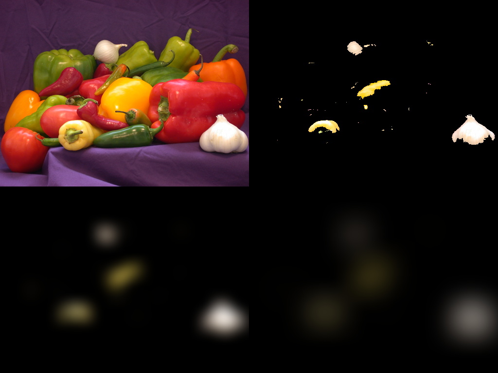

Markdown
# Specular Bloom Engine (MATLAB)

An optical diffusion and High Dynamic Range (HDR) specular bloom engine implemented from scratch in MATLAB. The engine models real-world lens glare by isolating high-energy specular highlights and diffusing them across a dual-kernel spatial Point Spread Function (PSF).

---

## Visual Demonstration

### Isolated Crystal Specular Bloom
A comparison demonstrating highlight isolation on reflective crystal facets while preserving background diffuse surfaces:


### Multi-Scale Gaussian Spatial Diffusion
Deconstruction of the dual-kernel Point Spread Function showing core glint ($\sigma = 3$) vs. ambient optical haze ($\sigma = 14$):



---

## Mathematical & Algorithmic Formulation

### 1. Perceptual Luminance Extraction
Color channels are mapped to perceptual luminance using ITU-R BT.601 coefficients to account for human photopic eye sensitivity:

$$Y = 0.299R + 0.587G + 0.114B$$

### 2. High-Pass Highlight Thresholding
Specular highlights are extracted by high-pass thresholding the normalized luminance map $Y(x, y) \in [0.0, 1.0]$:

$$M(x, y) = \begin{cases} 1, & Y(x, y) \ge \tau \\ 0, & Y(x, y) < \tau \end{cases}$$

$$I_{\text{highlights}}(x, y) = I_{\text{base}}(x, y) \cdot M(x, y)$$

### 3. Dual-Kernel Point Spread Function (PSF)
Natural optical bloom consists of an intense central gleam paired with a wide, soft atmospheric dispersion. The composite optical field blends two distinct 2D Gaussian kernels:

$$I_{\text{diffused}} = w_{\text{tight}} \cdot G_{\sigma_{\text{tight}}}(I_{\text{highlights}}) + w_{\text{wide}} \cdot G_{\sigma_{\text{wide}}}(I_{\text{highlights}})$$

Where $w_{\text{tight}} = 0.65$ and $w_{\text{wide}} = 0.35$.

### 4. Normalized HDR Additive Blending
The diffused energy field is amplified by a bloom gain factor $\alpha$ and composited back onto the base image, clamped to avoid dynamic range wrapping or saturation blowout:

$$I_{\text{bloom}}(x, y) = \min\left(1.0, \, I_{\text{base}}(x, y) + \alpha \cdot I_{\text{diffused}}(x, y)\right)$$

---

## File Structure

├── applyBloomEngine.m           # Modular, parameterized bloom engine function
├── cinderella_slipper_tuned.m   # Driver script demonstrating tuned crystal bloom
├── glass_asset.jpg              # Demonstration test input
├── cinderella_slipper_tuned.png # Before/After comparative output
├── milestone_1_3_diffusion_output.png # PSF decomposition analysis
└── LICENSE                      # MIT License


---

## Quickstart

Run the demonstration driver directly in MATLAB:

```matlab
% Read input asset
img = imread('glass_asset.jpg');

% Execute bloom engine with custom parameters
% applyBloomEngine(image, threshold, bloomGain, sigmaTight, sigmaWide)
output = applyBloomEngine(img, 0.90, 1.8, 3, 14);

% Display result
imshowpair(img, output, 'montage');
License
Distributed under the MIT License.


After pasting:
1. Click the green **Commit changes...** button in the upper right.
2. In the modal, click **Commit changes** to save.
